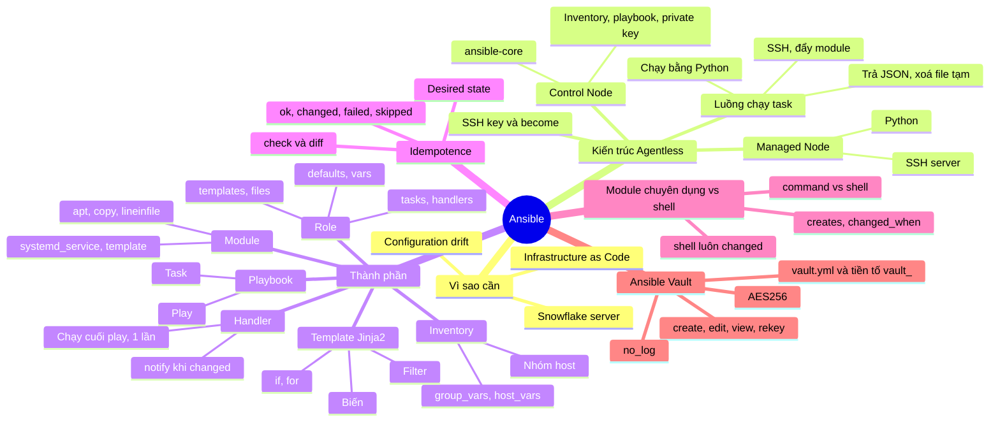

# Nội dung slide Seminar Ansible (bản rút gọn theo đề tài số 9)

---

## Phần 1 — Bài toán thực tế & sự ra đời của Ansible

**Slide 1. Tiêu đề**
Ansible Configuration Management — Agentless, Idempotent, Infrastructure as Code.

**Slide 2. Bài toán: từ 1 server lên 50 server**
Một công ty khởi nghiệp chạy web trên 1 server, sysadmin SSH vào cài nginx, sửa config bằng tay. Một năm sau hệ thống có 50 server:
- Sáng thứ Hai cần **vá khẩn một lỗ hổng OpenSSL** trên cả 50 máy → SSH vào từng máy, gõ lại cùng một chuỗi lệnh.
- Đổi một dòng trong `nginx.conf` → làm 50 lần, sót 3 máy mà không ai biết.
- Server số 17 chết → không ai nhớ nó từng được cấu hình những gì.

**Slide 3. Thử giải bằng tay và bằng script bash**

| | Làm tay | Script bash (`for host in ...; ssh ...`) |
|---|---|---|
| Nhiều máy | Rất tốn công, dễ sót | Tự viết vòng lặp, tự xử lý lỗi |
| Chạy lại | Gõ lại từ đầu | Lỗi ở bước đã làm rồi (`mkdir: File exists`, `useradd: already exists`) |
| Biết máy đang ra sao | Không | Không |
| Tài liệu hoá | Nằm trong đầu người làm | Script dài, khó đọc |

Hậu quả:
- **Configuration drift**: mỗi máy lệch đi một kiểu sau nhiều lần sửa tay.

**Slide 4. Hướng giải: Configuration Management & IaC**
- Không viết *"làm thế nào"* mà **mô tả trạng thái mong muốn**: "nginx phải được cài, config phải có nội dung X, service phải đang chạy".
- Công cụ tự so sánh với hiện trạng và chỉ sửa phần lệch → chạy lại bao nhiêu lần cũng an toàn (**idempotent**).
- **Infrastructure as Code**: cấu hình là file code → lưu Git, review, dựng lại server từ file.

**Slide 5. Thế hệ công cụ đầu tiên và cái giá phải trả**

| Công cụ | Năm | Agent | Mô hình | Ngôn ngữ |
|---|---|---|---|---|
| CFEngine | 1993 | Có agent | Pull | DSL riêng |
| Puppet | 2005 | Có agent | Pull | Puppet DSL |
| Chef | 2009 | Có agent (Chef Infra Client) | Pull | Ruby DSL |
| Salt | 2011 | `salt-minion` (Salt SSH thì agentless) | Push / lịch chạy | YAML + Jinja2 |

Giải quyết được bài toán, nhưng phải:
- Cài và cập nhật **agent trên từng máy**, dựng **server trung tâm**, quản lý **chứng chỉ/key**.
- Học **DSL hoặc Ruby** trước khi viết được cấu hình đầu tiên.

**Slide 6. Ansible ra đời (2012)**
- Michael DeHaan (tác giả Cobbler, đồng tác giả Func ở Red Hat) phát hành Ansible năm 2012; **Red Hat mua lại năm 2015**.
- Ý tưởng: tận dụng thứ máy Linux nào cũng có sẵn — **SSH và Python**:
  - **Agentless**: không cài agent, không cần server trung tâm.
  - **YAML** đọc như tài liệu, bắt đầu được trong vài phút.
  - **Push**: chạy khi bạn ra lệnh (vẫn có `ansible-pull` nếu cần pull).
- Tên lấy từ thiết bị liên lạc tức thời giữa các hành tinh trong truyện khoa học viễn tưởng của Ursula K. Le Guin.

---

## Phần 2 — Kiến trúc Agentless

**Slide 7. Agentless là gì?**
- **Agent** = chương trình chạy thường trực trên mỗi máy được quản lý, liên lạc với server trung tâm để nhận cấu hình (Puppet agent, Chef Infra Client, salt-minion).
- **Agentless** = không cài agent riêng của Ansible trên máy đích. Ansible chỉ cài trên **Control Node**, khi cần thì kết nối tới **Managed Node** qua kênh có sẵn (**SSH** với Linux, WinRM/SSH với Windows), làm xong thì rút ra.

```
MÔ HÌNH AGENT (Puppet, Chef)                 MÔ HÌNH AGENTLESS (Ansible)

   ┌───────────────────┐                        ┌───────────────────┐
   │ Server trung tâm  │                        │   Control Node    │
   │ (catalog, CA/key) │                        │ (cài Ansible)     │
   └───────────────────┘                        └───────────────────┘
        ▲         ▲                                  │         │
 agent tự kéo  agent tự kéo                   SSH khi ra lệnh  SSH khi ra lệnh
  (định kỳ)     (định kỳ)                            ▼         ▼
   ┌────────┐  ┌────────┐                        ┌────────┐ ┌────────┐
   │ Máy 1  │  │ Máy 2  │                        │ Máy 1  │ │ Máy 2  │
   │ +agent │  │ +agent │                        │ sshd   │ │ sshd   │
   └────────┘  └────────┘                        └────────┘ └────────┘
```

| | Có agent | Agentless |
|---|---|---|
| Cài trên máy đích | Agent + cập nhật agent | Không cài gì thêm (dùng SSH, Python có sẵn) |
| Hạ tầng phụ | Server trung tâm, CA/key cho từng agent | Chỉ cần Control Node |
| Tài nguyên máy đích khi rảnh | Agent chạy nền | Không có tiến trình thường trực |
| Tự sửa drift | Có (agent chạy định kỳ) | Chỉ khi chạy lại playbook (hoặc lập lịch) |
| Quy mô rất lớn | Tốt (máy tự kéo cấu hình) | Control Node chịu tải kết nối song song |

- Agentless **≠ máy đích không cần gì**: vẫn cần **SSH server**, **Python** (cho phần lớn module) và tài khoản có quyền phù hợp.
- Agent/agentless (có cài agent hay không) và push/pull (bên nào chủ động) là **hai tiêu chí độc lập**.

**Slide 8. Yêu cầu của Control Node và Managed Node**

| | Control Node | Managed Node (Linux) |
|---|---|---|
| Ansible | Cài `ansible` / `ansible-core` | Không cần |
| Python | Phiên bản được bản Ansible hỗ trợ | Cần cho phần lớn module (không bắt buộc cùng phiên bản với Control Node) |
| SSH | SSH client | SSH server đang chạy, mở cổng TCP 22 |
| Khác | Inventory, playbook, private key | Tài khoản có shell; quyền `sudo` nếu task cần root |

- Control Node phải là Linux/macOS (Windows thì dùng WSL); Managed Node có thể là Windows.
- Module `raw` chạy được cả khi máy đích chưa có Python → dùng để cài Python lần đầu.

**Slide 9. Một task chạy như thế nào?**
1. Control node đọc inventory, playbook, biến → đóng gói module + tham số.
2. SSH vào managed node, tạo thư mục tạm, chuyển mã module sang.
3. Managed node chạy module bằng Python (dùng `become` nếu cần quyền root).
4. Module trả **JSON** → Ansible báo `ok` / `changed` / `failed`.
5. Xoá file tạm; kết quả task (gói, file cấu hình) vẫn giữ.

**Slide 10. Lab & SSH key**

```
┌──────────────────────┐   SSH (TCP 22)    ┌──────────────────────┐
│ control 192.168.56.10│ ────────────────► │ managed 192.168.56.20│
│ ansible-core, key    │                   │ sshd, python3, sudo  │
└──────────────────────┘                   └──────────────────────┘
```

```bash
ssh-keygen -t ed25519 -f ~/.ssh/ansible_lab
ssh-copy-id -i ~/.ssh/ansible_lab.pub student@192.168.56.20
ansible web -m ansible.builtin.ping      # "pong" = SSH + Python OK (không phải ICMP)
```

```ini
# ansible.cfg
[defaults]
inventory = inventory.ini
remote_user = student
private_key_file = ~/.ssh/ansible_lab
```

- Private key **không bao giờ rời control node**; public key nằm trong `authorized_keys` của máy đích.
- `become: true` = chạy bằng `sudo`; **không tự cấp quyền** sudo. `-K` hỏi mật khẩu sudo.

---

## Phần 3 — Các thành phần cơ bản

**Slide 11. Bức tranh tổng thể**

```
Inventory ──► Playbook ──► Play (nhóm máy + danh sách việc)
                            ├── Task ──► module apt
                            ├── Task ──► module template ──notify──► Handler
                            └── Task ──► module systemd_service
              Role = đóng gói tasks/handlers/templates/vars thành thư mục chuẩn
```

**Slide 12. Inventory**

```ini
[web]
managed ansible_host=192.168.56.20
```

- Nhóm mặc định `all`; biến tách ra `group_vars/` và `host_vars/`.
- Cụ thể hơn thắng: `host_vars` > `group_vars/<nhóm>` > `group_vars/all`.

**Slide 13. Playbook & Task**

```yaml
- name: Cài nginx
  hosts: web
  become: true
  tasks:
    - name: Đảm bảo nginx đã cài
      ansible.builtin.apt:
        name: nginx
        state: present
```

- Play: `hosts`, `become`, `vars`, `tasks` (chạy từ trên xuống), `handlers`.
- Task = `name` + module + tham số; hay kèm `when`, `loop`, `register`, `notify`.
- YAML: thụt lề bằng **space**, `key: value`, list bắt đầu `- `.
- Ad-hoc (`ansible web -m ping`) = 1 lệnh dùng ngay; playbook = lưu Git, chạy lại được.

**Slide 14. Role**

```
roles/nginx/
├── tasks/main.yml      # task chính
├── handlers/main.yml   # handler
├── templates/          # file .j2
├── files/              # file tĩnh
├── defaults/main.yml   # biến mặc định — dễ ghi đè
└── vars/main.yml       # biến cố định của role
```

- Role không tự chạy; playbook gọi bằng `roles: [nginx]`.
- Ưu tiên biến: `defaults` < `group_vars` < `host_vars` < `-e` (extra vars luôn thắng).

**Slide 15. Template Jinja2**
- `{{ biến }}` in giá trị · `` / `` điều khiển · `{# #}` comment.
- Filter hay dùng: `default(80)`, `join(' ')`.
- Render **trên control node** rồi mới đẩy file sang máy đích.

```jinja
server {
    listen {{ nginx_port | default(80) }};
    server_name {{ server_name }};

    location {{ loc.path }} { proxy_pass {{ loc.backend }}; }

}
```

| | `copy` | `template` |
|---|---|---|
| Nội dung | Nguyên văn | Render biến rồi đẩy |
| Dùng cho | File tĩnh | File đổi theo host/môi trường |

**Slide 16. Handler**
- Chỉ chạy khi task `notify` báo **`changed`** — config không đổi thì không restart.
- Chạy **cuối play**, **1 lần mỗi host** dù được notify nhiều lần.
- Tên trong `notify` phải khớp tên handler.

```yaml
- name: Render nginx.conf
  ansible.builtin.template:
    src: nginx.conf.j2
    dest: /etc/nginx/nginx.conf
    validate: nginx -t -c %s
  notify: Restart nginx

# handlers/main.yml
- name: Restart nginx
  ansible.builtin.systemd_service:
    name: nginx
    state: restarted
```

Ghi chú: đề yêu cầu *restart*; thực tế nên dùng `state: reloaded` (không downtime) khi chỉ đổi config.

---

## Phần 4 — Idempotence

**Slide 17. Idempotent là gì?**
- Chạy 1 lần hay 100 lần → máy luôn ở **cùng trạng thái mong muốn**, không tác dụng phụ.
- Ví dụ: bấm nút tầng 5 thang máy (idempotent) vs nút toggle đèn (không).

| Idempotent | Không idempotent |
|---|---|
| `mkdir -p /data` | `mkdir /data` (lần 2 lỗi) |
| `echo X > file` | `echo X >> file` (nhân bản dòng) |

**Slide 18. Khai báo vs Mệnh lệnh**
- Shell script: *"làm thế nào"*. Ansible: *"kết quả cuối là gì"*.
- Module: kiểm tra hiện trạng → khớp thì `ok`, lệch thì sửa vừa đủ → `changed`.

| PLAY RECAP | Ý nghĩa |
|---|---|
| `ok` | Thành công (bao gồm cả `changed`) |
| `changed` | Đã thay đổi máy đích |
| `failed` | Lỗi, dừng play trên host đó |
| `skipped` | `when` trả về false |

**Slide 19. Xem trước: `--check` & `--diff`**
- `--check`: mô phỏng, không đổi gì. `--diff`: hiện dòng thêm/bớt trong file.
- Giới hạn: `shell`/`command` bị **skip** trong check mode (trừ khi có `creates`/`removes`).

---

## Phần 5 — Module chuyên dụng vs Shell/Command

**Slide 20. `command` vs `shell`**

| | `command` | `shell` |
|---|---|---|
| Chạy qua `/bin/sh` | Không | Có |
| Pipe, redirect, `$VAR` | Không | Có |
| Rủi ro shell injection | Thấp | Cao |

- Bẫy: `command: echo data >> /tmp/x` → **không tạo file** (`>>` thành đối số) nhưng vẫn báo `changed`.
- `raw` (không cần Python, dùng bootstrap) và `script` (chạy script có sẵn) chỉ dùng trường hợp đặc biệt.

**Slide 21. Vì sao module chuyên dụng tốt hơn?**
- `shell`/`command` là "hộp đen": Ansible chỉ thấy `rc`, `stdout` → **luôn báo `changed`**.
- Module chuyên dụng kiểm tra trước khi làm:
  - `copy`: so checksum, giống thì `ok`.
  - `lineinfile`: dòng đã có thì `ok`, chưa có thì thêm.
  - `systemd_service`: `state: started` chỉ khởi động khi đang dừng.
- Kèm theo: hỗ trợ `--check`/`--diff`, trả dữ liệu có cấu trúc, an toàn hơn, dễ đọc.

**Slide 22. Khi buộc phải dùng shell**

```yaml
- ansible.builtin.shell: tar -xzf app.tar.gz -C /opt/app
  args:
    creates: /opt/app/README     # đã có file này thì bỏ qua

- ansible.builtin.command: uname -r
  changed_when: false            # lệnh chỉ đọc
```

---

## Phần 6 — Ansible Vault

**Slide 23. Vault là gì?**
- Secret để plain text trong Git sẽ lộ vĩnh viễn (Git nhớ lịch sử).
- Vault mã hoá **AES256** → secret vẫn nằm trong Git nhưng đã mã hoá.
- Lệnh: `create`, `encrypt`, `view`, `edit`, `decrypt`, `rekey`.
- Chạy: `--ask-vault-pass` (chạy tay) hoặc `--vault-password-file` (tự động; file `chmod 600` + `.gitignore`).

**Slide 24. Cách tổ chức**

```
group_vars/web/
├── vars.yml    # công khai:  app_secret: "{{ vault_app_secret }}"
└── vault.yml   # ĐÃ MÃ HOÁ:  vault_app_secret: "..."
```

- Tiền tố `vault_` → grep được tên biến, biết ngay giá trị thật nằm trong vault.
- Task dùng secret thêm `no_log: true` để không in secret ra màn hình.

---

## Phần 7 — Demo

**Slide 25. Demo 1 + 2 — Role Nginx, Template & Handler**
1. `ansible web -m ping` → chứng minh SSH key hoạt động.
2. `ansible-playbook site.yml` → role `nginx`: cài gói, render template, `started + enabled`.
3. Chạy lại → `changed=0`, **handler không chạy**.
4. Đổi biến (vd `nginx_port`) → template `changed` → **handler restart nginx**.
5. `curl http://192.168.56.20:<port>` kiểm chứng.

**Slide 26. Demo 3 — Ansible Vault**
1. `ansible-vault create group_vars/web/vault.yml` → `cat` thấy `$ANSIBLE_VAULT;1.1;AES256`.
2. Chạy playbook thiếu mật khẩu → lỗi; thêm `--ask-vault-pass` → chạy được.
3. Trên managed node, file secret được tạo với quyền `0600`; output không lộ secret nhờ `no_log`.

**Slide 27. Demo 4 — Sự cố & Idempotency**
1. Task `shell: echo "data" >> /file.txt`, chạy 3 lần → `cat /file.txt` có **3 dòng `data`**, lần nào cũng `changed`.
2. Xoá file, sửa task thành `lineinfile: path=/file.txt line=data create=true`.
3. Chạy 3 lần → lần 1 `changed=1`, lần 2 và 3 **`changed=0`**, file chỉ có 1 dòng.

Lưu ý: phải xoá file trước bước 2, nếu không `lineinfile` thấy dòng đã có và báo `ok` ngay từ lần đầu. Ghi vào `/` cần `become: true`.

**Slide 28. Tổng kết & Hỏi đáp**
- Agentless qua SSH; khai báo trạng thái; idempotent; ưu tiên module chuyên dụng.
- Câu hỏi hay gặp:
  1. Ansible khác shell script? → Khai báo trạng thái, idempotent, chạy nhiều máy, không agent.
  2. `command` khác `shell`? → `shell` qua `/bin/sh`; `command` an toàn hơn.
  3. Handler chạy khi nào? → Cuối play, khi task notify báo `changed`, mỗi host 1 lần.
  4. `defaults` hay `vars`? → Cho người dùng chỉnh → `defaults`; cố định → `vars`.

**Slide 29. Mindmap kiến thức Ansible**



Bản ASCII (dùng khi công cụ làm slide không vẽ được Mermaid):

```
                                   ┌─ Vì sao cần ──── drift · snowflake server · IaC
                                   │
                                   ├─ Agentless ───── Control Node (ansible-core)
                                   │                  Managed Node (SSH + Python)
                                   │                  SSH → đẩy module → JSON → dọn file tạm
                                   │                  SSH key · become
                                   │
                                   ├─ Thành phần ──── Inventory (nhóm, group_vars/host_vars)
                                   │                  Playbook → Play → Task → Module
                                   │                  Role (tasks/handlers/templates/defaults/vars)
              ┌─────────┐          │                  Template Jinja2 ({{ }}, if/for, filter)
              │ ANSIBLE │──────────┤                  Handler (notify khi changed, chạy 1 lần)
              └─────────┘          │
                                   ├─ Idempotence ─── desired state · ok/changed/failed/skipped
                                   │                  --check · --diff
                                   │
                                   ├─ Module vs Shell ─ command vs shell · shell luôn changed
                                   │                    creates · changed_when
                                   │
                                   └─ Vault ───────── AES256 · create/edit/view/rekey
                                                      vault.yml + tiền tố vault_ · no_log
```

**Slide dự phòng (chỉ mở khi bị hỏi)**
- Handler nâng cao: `listen` (gom handler theo topic), `meta: flush_handlers` (chạy ngay), `force_handlers` (chạy dù task sau lỗi).
- `reloaded` (HUP, không downtime) vs `restarted` (dừng rồi chạy lại).
- `encrypt_string`: mã hoá từng giá trị, tên biến vẫn đọc được.

---

## Phụ lục — Ghi chú nguồn

**Nguồn đã giữ cho từng chủ đề:** Agentless/SSH/become → `Tran-ansible-agentless-ssh`; so sánh công cụ → `Tran_compare`; idempotence → `idempotent.md`; shell vs module → `module-shell.md`; template, handler, facts → `jinja2-nginx.md`; role, ưu tiên biến → `GhiChu-Role.md`; vault → `ansible-vault.md`.

**Chỗ sai trong docs gốc đã sửa:**
- `module-shell.md`: handler chạy "cuối Playbook" → đúng là cuối mỗi phần của play.
- `configuration-management.md`: gộp push = không agent, pull = có agent → hai tiêu chí độc lập.
- `module-shell.md`: `copy` so "SHA1 / MD5" → SHA1.
- `idempotent.md`: shell luôn bị skip trong check mode → trừ khi có `creates`/`removes`.
- `GhiChu-Inventory-Playbook.md`: `ansible_os_family` → nên dùng `ansible_facts['os_family']`.

**Đã lược bỏ khỏi slide:** chi tiết bảo mật và mở rộng của Puppet/Chef/Salt, dynamic inventory, bảng 22 mức ưu tiên biến, Ansible Galaxy, bảng filter Jinja2 và whitespace control, chi tiết `raw`/`script` và cây quyết định, PLAY RECAP `unreachable`/`rescued`/`ignored`, phân tích byte UTF-8, demo chạy trên localhost.
