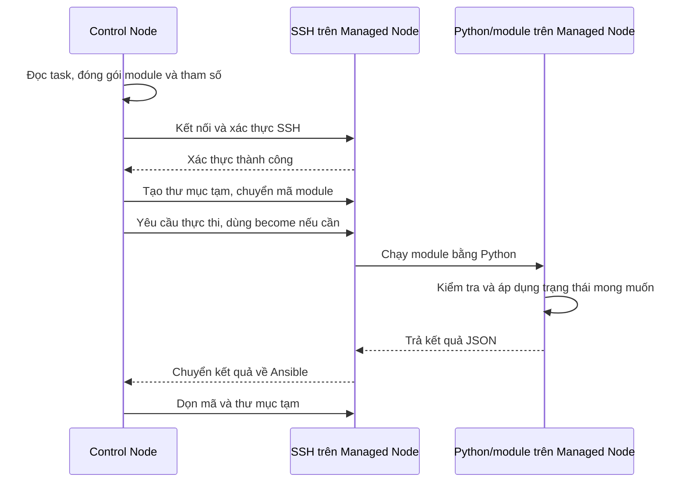

# Task 2: Ansible Agentless và kết nối SSH

Phạm vi: hai VM Linux, một Control Node và một Managed Node, quản lý qua SSH.

## 1. Agentless là gì?

Agentless nghĩa là không cần cài agent riêng của Ansible chạy thường trực trên máy được quản lý. Ansible được cài trên **Control Node**, kết nối đến **Managed Node** để thực hiện công việc.

Máy đích vẫn cần SSH và thường cần Python để chạy module. Agentless không có nghĩa là máy đích không cần phần mềm hỗ trợ. Khi Ansible chạy xong, dịch vụ như Nginx vẫn hoạt động độc lập. [[1]](#nguồn-1)

## 2. Quy trình chạy module qua SSH

Module là đơn vị thực hiện công việc, chẳng hạn quản lý package, file hoặc dịch vụ. Với module Python chạy từ xa theo cách dùng file tạm thông thường: [[2]](#nguồn-2)

1. **Chuẩn bị mã:** Control Node đọc Inventory, Playbook và biến; đóng gói module cùng tham số thành mã thực thi. Không phải chuyển toàn bộ Playbook thành một shell script.
2. **Kết nối và copy:** xác thực SSH, tạo thư mục tạm trên Managed Node và chuyển mã module sang.
3. **Chạy:** Managed Node dùng Python thực thi module; có thể dùng `become` nếu cần quyền cao hơn.
4. **Nhận kết quả:** module trả dữ liệu, thường dạng JSON, để Ansible báo `ok`, `changed` hoặc `failed`.
5. **Dọn dẹp:** Ansible thông thường xóa mã và thư mục tạm của lần chạy. File cấu hình hoặc phần mềm mà task tạo ra vẫn được giữ.



**Ngoại lệ:** khi bật *pipelining*, một số module Python được truyền vào stdin của Python từ xa, không cần copy thành file module tạm. Một số action như `debug` chạy trên Control Node. Vì vậy, luồng trên không áp dụng cho mọi task. [[2]](#nguồn-2)[[3]](#nguồn-3)

## 3. Yêu cầu của hai máy

| Thành phần | Control Node | Managed Node Linux |
|---|---|---|
| Ansible | Cài `ansible` hoặc `ansible-core` | Không cần cài Ansible |
| Python | Cần phiên bản được bản Ansible sử dụng hỗ trợ | Cần cho phần lớn module Python; phiên bản phải được hỗ trợ |
| SSH | Có SSH client và kết nối được đến máy đích | SSH server đang chạy; cho phép tài khoản đăng nhập |
| Dữ liệu/quyền | Inventory, Playbook và thông tin xác thực | Tài khoản có POSIX shell; quyền phù hợp với task |
| Kết nối mạng | Truy cập được cổng SSH của máy đích | Cho phép kết nối SSH, thường TCP 22 |

Hai máy không bắt buộc dùng cùng phiên bản Python. Kiểm tra ma trận hỗ trợ theo phiên bản `ansible-core`. Module như `raw` có thể dùng để chạy lệnh mà không cần Python trên máy đích. [[1]](#nguồn-1)[[2]](#nguồn-2)[[7]](#nguồn-7)

512 MB RAM mỗi VM là yêu cầu của bài, không phải mức tối thiểu chung do Ansible công bố. Khi thực hành nên dùng hệ điều hành server không có giao diện đồ họa và kiểm tra tài nguyên thực tế.

## 4. SSH key-based authentication và password

| Tiêu chí | Password | SSH key |
|---|---|---|
| Cách xác thực | Dùng mật khẩu tài khoản trên máy đích | Dùng cặp private key và public key |
| Vị trí lưu | Mật khẩu được nhập khi kết nối hoặc cung cấp qua cơ chế quản lý secret | Private key ở Control Node; public key trong `authorized_keys` của tài khoản máy đích |
| Tự động hóa | Cần cung cấp mật khẩu cho lần chạy | Thuận tiện cho tự động hóa; key có passphrase có thể dùng `ssh-agent` |
| Điểm cần bảo vệ | Mật khẩu | Private key và passphrase |

Cả hai đều xác thực trên kết nối SSH được mã hóa. Với key, client dùng private key để chứng minh quyền sở hữu; **private key không được gửi sang máy đích**. [[4]](#nguồn-4)[[5]](#nguồn-5)

`~/.ssh/authorized_keys` trên Managed Node chứa các public key được phép đăng nhập vào **tài khoản sở hữu file đó**. Đây là đường dẫn thông thường, có thể được SSH server cấu hình khác. `known_hosts` ở phía client dùng để nhận diện server, có vai trò khác `authorized_keys`. [[5]](#nguồn-5)[[6]](#nguồn-6)

Ví dụ chạy trên Control Node, thay `192.168.56.20` và `student` bằng IP và tài khoản thật:

```bash
# Tạo cặp key riêng cho bài thực hành; đặt passphrase khi được hỏi
ssh-keygen -t ed25519 -f ~/.ssh/ansible_lab

# Cài public key vào tài khoản student trên Managed Node
ssh-copy-id -i ~/.ssh/ansible_lab.pub student@192.168.56.20

# Kiểm tra đăng nhập bằng key
ssh -i ~/.ssh/ansible_lab student@192.168.56.20
```

`ssh-copy-id` thường cần mật khẩu tài khoản trong lần thiết lập đầu tiên. File `ansible_lab` là private key; file `ansible_lab.pub` là public key.

Inventory minh họa:

```ini
[web]
managed ansible_host=192.168.56.20 ansible_user=student ansible_ssh_private_key_file=~/.ssh/ansible_lab
```

Nếu key có passphrase, nạp key vào một `ssh-agent` đang chạy bằng `ssh-add ~/.ssh/ansible_lab`. Ansible khuyến nghị cách này để tránh phải nhập passphrase cho từng kết nối. [[4]](#nguồn-4)

## 5. become: nâng quyền sau khi đăng nhập

`become` cho phép task chạy dưới tài khoản khác, thường là `root` qua `sudo`. Tài khoản SSH và tài khoản thực thi task có thể khác nhau. [[3]](#nguồn-3)

Ví dụ `nginx.yml` cho Ubuntu/Debian:

```yaml
---
- name: Cai dat Nginx
  hosts: web
  become: true
  become_method: sudo
  become_user: root
  tasks:
    - name: Dam bao Nginx da duoc cai
      ansible.builtin.apt:
        name: nginx
        state: present
        update_cache: true
```

```bash
ansible-playbook -i inventory.ini nginx.yml --ask-become-pass
```

Trong ví dụ, Ansible đăng nhập bằng `student`, rồi dùng `sudo` để chạy task với quyền `root`. `student` phải được cấp quyền sudo phù hợp; `become: true` không tự cấp quyền. `--ask-become-pass` (hoặc `-K`) hỏi mật khẩu nâng quyền; `--ask-pass` (hoặc `-k`) hỏi mật khẩu SSH. [[3]](#nguồn-3)[[4]](#nguồn-4)

Để kiểm tra SSH và Python trước khi chạy task cài đặt:

```bash
ansible -i inventory.ini web -m ansible.builtin.ping
```

Kết quả thành công có `pong`. Đây là module kiểm tra khả năng kết nối và chạy Python, không phải ping ICMP. [[8]](#nguồn-8)

## Tài liệu chính thức

### Nguồn 1

[Ansible: yêu cầu Control Node và Managed Node](https://docs.ansible.com/projects/ansible/latest/installation_guide/intro_installation.html).
### Nguồn 2

[Ansible: kiến trúc và quy trình thực thi module](https://docs.ansible.com/projects/ansible/latest/dev_guide/developing_program_flow_modules.html).
### Nguồn 3

[Ansible: become, file tạm và pipelining](https://docs.ansible.com/projects/ansible/latest/playbook_guide/playbooks_privilege_escalation.html).
### Nguồn 4

[Ansible: kết nối SSH, key, ssh-agent và mật khẩu](https://docs.ansible.com/projects/ansible/latest/inventory_guide/connection_details.html).
### Nguồn 5

[OpenSSH: sshd và authorized_keys](https://man.openbsd.org/sshd.8).
### Nguồn 6

[OpenSSH: SSH client và known_hosts](https://man.openbsd.org/ssh.1).
### Nguồn 7

[Ansible: ma trận hỗ trợ phiên bản Python](https://docs.ansible.com/projects/ansible/latest/reference_appendices/release_and_maintenance.html).
### Nguồn 8

[Ansible: module ping](https://docs.ansible.com/projects/ansible/latest/collections/ansible/builtin/ping_module.html).

Các lệnh là ví dụ tham khảo, chưa được chạy trên hai VM của bài thực hành.
